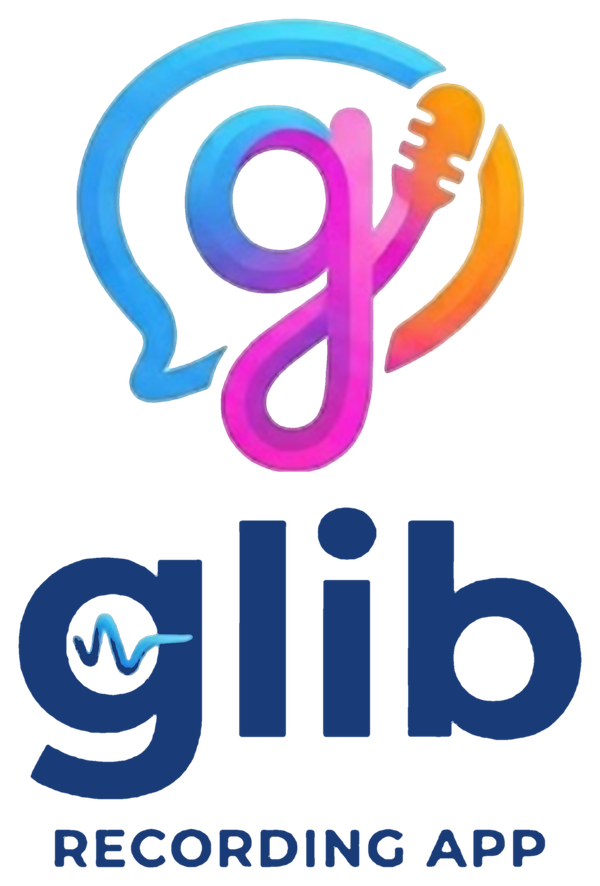

# glib

A recording app for narration that is read from a script. It runs entirely on your own
computer: after the one-time set-up, nothing you record leaves it.

Glib shows the script one sentence at a time. For every line you record it can:

- **Polish** your real recording: remove "um" and "uh", repeated words and false starts,
  shorten long pauses, remove background noise and give it a finished, even sound. It compares
  what you said with the script and points out wrong or missing words.
- **Rebuild** the line: a natural British reader says the script exactly as written, and Glib
  speaks that reading in your voice, learned from samples of your voice. No slips, a neutral
  accent and a livelier delivery.

You choose, line by line, which version goes into the final audio file. Every line, polished or
rebuilt, goes through the same finishing chain, so the whole recording sounds consistent.

## Install (Windows 10 or 11, 64-bit)

1. Run **GlibSetup.exe**. If Windows shows a blue "Windows protected your PC" box, choose
   **More info**, then **Run anyway** (the installer is not code-signed yet).
2. Follow the steps. No administrator rights are needed; Glib installs for your user only.
3. The first time Glib opens, it downloads its voice engines (about 1.2 GB) once.

To uninstall, use **Settings > Apps** in Windows. Your recordings and voice samples are kept in
`%LOCALAPPDATA%\Glib` until you delete that folder yourself.

## Use

1. **My Voice**: read the text on screen for a few minutes, in a quiet room with soft furnishings.
   Five minutes or more gives the best match. Each sample gets a quality check.
2. **Record**: paste a script, press **Space**, read the line, press **Space** again.
   Green means the take matches the script. Amber means it needs a second look.
3. Use **Rebuild this line** for lines that are hard to get right, or **Rebuild every line**
   for a whole script in the neutral accent.
4. **Export the audio** saves one 24-bit WAV file at your chosen loudness, ready for the video editor.

**Settings** has noise removal strength, the loudness target (-14 LUFS for YouTube, -16 LUFS to
leave room for music), pause lengths, reading speed, the British reader, and a "Say it this way"
list for words that are spoken differently from how they are written (NASA is said "nasa").

## How it works

| Step | What happens |
|---|---|
| Listening | NVIDIA Parakeet compares each take with the script, word by word |
| Polish | Slips are cut at the quietest nearby moment with short crossfades; each cut is kept only if a second listen confirms the line is closer to the script |
| Rebuild | Kokoro reads the line with a British accent, then the Chatterbox voice converter speaks it in your voice, using the cleanest 10 seconds of your samples and your speaker identity averaged across all of them |
| Finishing | Rumble filter, neural noise removal at 48 kHz (DPDFNet), narration EQ, de-esser, compressor, loudness to a LUFS target (ITU-R BS.1770) and a true-peak limiter at -1 dBTP |

## Good to know

- No graphics card is needed. Polish takes a few seconds per line; Rebuild takes a little longer.
- Polish only keeps a cut after listening again and confirming the line is closer to the script.
  If a slip cannot be removed cleanly, it says so instead of damaging the take.
- The word check is advice, not a verdict: unusual words, names and numbers are sometimes misheard.
- Rebuilt audio is computer-generated speech in your voice. Use it only with your own voice.

## Support

If Glib saves you time, you can buy me a coffee on Ko-fi. It helps me keep adding features and fixing problems.

## Licence

Free for noncommercial use under the PolyForm Noncommercial License 1.0.0 (LICENSE.md).
Commercial use needs a separate licence (COMMERCIAL-LICENSE.md). The voice engines have their
own licences (THIRD-PARTY-NOTICES.md).

## For developers

Python 3.12. `glib/` holds the app: `server.py` (local web server), `pipeline.py` (Polish,
Rebuild, export), `master.py` (finishing chain), `align.py` (script comparison), `asr.py`,
`tts.py`, `vc.py` (voice conversion), `models.py` (engine downloads) and `web/index.html`
(the interface). Run from source with `pip install -r requirements.txt` then `python -m glib`.
The installer is built and tested on Windows by `.github/workflows/windows.yml` from
`installer/glib.iss`.
